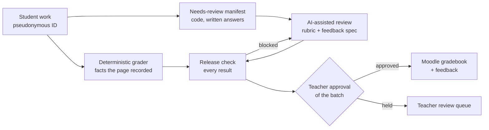

# FoxCS

**A live learning platform and hybrid AI-assisted assessment system for high school computer science.**

FoxCS is the Moodle-based learning environment and supporting tooling I designed, built, and operate for my own computer science courses. It combines interactive lesson content, structured assessment, deterministic grading, and AI-assisted feedback with a teacher approval gate in front of every result a student sees.

This repository is the public engineering showcase. It contains the grading code, its tests, an evaluation harness for AI-generated feedback, synthetic example data, and the architecture and decision records behind the system. Course content, student data, assessments, and licensed instructional material live in a separate private workspace and are not included here.


---

## The problem

Students learn faster when feedback tells them what they understand, where their work falls short, and what to do next. Writing that feedback by hand for every student on every assignment does not fit in a teacher's week. My own design constraint was **one hour per week** for grading and releasing feedback for an entire class.

Traditional autograders verify behavior reliably, but they cannot explain why a student's approach matters. Language models can explain, but they are probabilistic and can be confidently wrong. Neither one alone is good enough to put in front of a fifteen-year-old.

## The approach: three layers, each doing what it is reliable at



1. **Deterministic evaluation.** Two stdlib-only graders. One grades Coding Exercises the moment they are submitted: it runs the student's program against test inputs in an isolated process and scores whether it runs and whether the output is correct. The other runs weekly over lesson activity: whether work was saved, attempt counts, first-try correctness, time on a mastery check. Neither judges quality, and anything that needs judgment goes to a review manifest, so nothing is silently skipped.
2. **AI-assisted feedback.** Code, written answers, and projects go to an AI reviewer working from the assignment rubric and a detailed feedback specification: evidence-based voice, best-fit rubric scoring, a structured output schema, score validation rules, and fourteen explicit triggers for human review.
3. **Instructional oversight.** Nothing generated by AI reaches a student until the teacher approves it. High confidence is not an exception. Approval happens in batches, so an automated release check examines every result first, blocking what can't be right and flagging what needs a closer look.

The goal is to keep reliability where outcomes can be verified programmatically, and add useful explanation where context and interpretation matter.

## Bulk approval, checked: the release check

I don't re-read every AI-assisted grade. I read the rationale, check that the criteria are right and the grading trends look sound, and approve the batch. That's what fits in an hour a week, and it rests on an assumption: if the criteria are right and the rationale lines up, the grade is right. The [release check](docs/release-check.md) tests that assumption on every result before I see the batch.

| Group | What sends a result there |
|---|---|
| **Blocked** (the push can't run) | Wrong or missing rubric criteria, points that don't add up, an unapproved bonus, credit with no evidence, evidence quoting code that isn't in the student's file, or a grade that contradicts what happened when the program ran |
| **Needs review** | Full marks explained with a problem, zero explained with only praise, praise that doesn't fit the score, the grader asking for review, or the same feedback on different scores |
| **Ready** | Passed everything |

Each batch, it also draws a few ready results at random, spread across low, middle and high scores, for me to read in full. Agreement on those reads is the evidence that bulk approval is safe. The report includes the score spread and full-credit rate per criterion, the trends I already check. It exits with an error when anything is blocked, so a push script can refuse to run.

On known-good synthetic batches it raises no false alarms: the only results flagged are the ones the grader escalated itself. It has 68 tests, 100% line and branch coverage, and a 100% mutation score, up from 83.0% on the first mutation run.

## What is in this repository

| Path | What it is | Status |
|---|---|---|
| [`grader/`](grader/) | Weekly batch grader for lesson activity, synthetic submissions | Implemented, tested in CI |
| [`grader/on_submission.py`](grader/on_submission.py) | **On-submission grading** of Coding Exercises: runs the student's code in an isolated process the moment it is uploaded, scores 50% runs / 50% correct, returns a draft pending teacher approval | Implemented, **100% line and branch coverage** enforced in CI. Not yet connected to live Moodle |
| [`grader/release_check.py`](grader/release_check.py) | **Release check** before every bulk grade push: blocks results that can't be right (wrong rubric, bad arithmetic, invented evidence, contradicting the program run), flags score-rationale disagreements, draws a spot-check sample | Implemented, **100% line and branch coverage** enforced in CI |
| [`evals/`](evals/) | Evaluation harness for AI grading outputs: 6 adversarial cases, 11 deterministic checks per case, reference judgments, 48 tests | Implemented, tested in CI. Baseline model runs planned |
| [`examples/`](examples/) | Grader output from a real run on the synthetic submissions | Generated by the code in this repo |
| [`tools/`](tools/) | Leak scanner and fixture generator, with 9 repository-hygiene tests | Implemented, tested in CI |
| [`docs/`](docs/) | Architecture, grading pipeline, testing, AI reliability, privacy, engineering process, RAG roadmap | Current |

## Try it

Requires Python 3.10+ and nothing else.

```bash
# Grade the synthetic submissions
python grader/auto_grade.py grader/sample-submissions --out-dir out

# Grade one Coding Exercise submission the moment it arrives
python grader/on_submission.py examples/on-submission/event-runs-with-issues.json \
  --exercises grader/exercises --submissions-root grader/tests/on_submission_fixtures --store out/drafts.jsonl

# Check a batch of AI-assisted grades before a bulk push
python grader/release_check.py --outputs BATCH/outputs --rubrics evals/assignments --submissions BATCH/submissions

# Score AI grading outputs against the eval suite
python evals/run_evals.py --outputs evals/reference-outputs

# Mutation testing: every small change to the grading code must be caught by a test
python tools/mutation_test.py

# Run every test suite
python -m unittest discover -s grader/tests
python -m unittest discover -s evals/tests
python -m unittest discover -s tools/tests
```

See [docs/testing.md](docs/testing.md) for what each suite covers and what it does not.

## Engineering approach

- **Specification-driven development with an explicit authority hierarchy.** When two specs disagree, a written ranking decides which wins, and every real conflict found gets logged so the next build session does not repeat it. See [docs/engineering-process.md](docs/engineering-process.md).
- **Hard gates over good intentions.** After a real incident where prototype content reached students, publishing now runs through an automated check that fails the deploy. The same pattern runs here: CI fails if licensed or private material appears in this repository.
- **Tests that can fail, proven by mutation testing.** Coverage only shows every line ran. A stdlib mutation tester changes the grading code one small step at a time and requires a test to catch every change. Any exception is listed with a reason, and CI fails on anything else. At 100% coverage it still found dozens of untested behaviors, now covered.
- **Privacy by separation.** Real identities live in exactly one teacher-controlled roster. Every other system, including any AI tool, works on pseudonymous IDs only. See [docs/privacy-and-data.md](docs/privacy-and-data.md).
- **Honest status labels.** Every capability in [docs/grading-pipeline.md](docs/grading-pipeline.md) is marked deployed, implemented, in development, or planned.

## Project status

FoxCS is in daily use by real students. The Moodle platform, interactive lessons with in-browser Python, interaction telemetry through a custom Moodle plugin, and native quiz and assignment submission are deployed. The deterministic graders (including on-submission grading of Coding Exercises), the release check, and the eval harness are implemented and tested. The release check's first live use is the next bulk grade push. AI-assisted review is used in practice as a teacher-operated workflow, not an unattended service. The full capability table, including what is still planned, is in [docs/grading-pipeline.md](docs/grading-pipeline.md).

## Documentation

- [System architecture](docs/architecture.md)
- [Grading pipeline and capability status](docs/grading-pipeline.md)
- [On-submission grading](docs/on-submission-grading.md)
- [Release check before a bulk grade push](docs/release-check.md)
- [Assessment access: a daily class code](docs/assessment-access-design.md)
- [Testing and validation](docs/testing.md)
- [AI reliability and boundaries](docs/ai-reliability-and-boundaries.md)
- [Privacy and data boundaries](docs/privacy-and-data.md)
- [Engineering process](docs/engineering-process.md)
- [Retrieval (RAG) roadmap](docs/rag-roadmap.md)

## My role

Product strategy, UX and learning experience design, software development, system architecture, automation, technical documentation, testing, and ongoing operation. I am the sole developer and the teacher using it.

## About this repository

This showcase was extracted from a private operational workspace with fresh history. It contains no student data, no live assessment items or passwords, no licensed course material, and no deployment configuration. All student work in it is synthetic.
