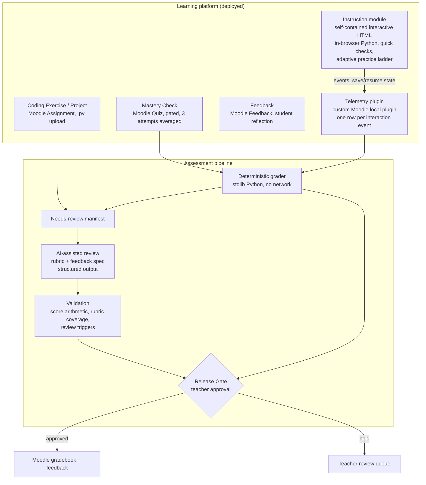

# System architecture

FoxCS spans two kinds of system: a live learning platform students use every day, and an assessment pipeline that turns their work into grades and feedback. This document covers both and where they meet.

## Overview

## The learning platform

**Moodle, self-hosted.** I run Moodle on my own cloud server with TLS, provisioned and maintained by hand. Nightly database and file backups run on a schedule, and a manual backup is the required first step before any live content edit.

**Each lesson is up to five modules**, a structure that settled after several iterations with real students:

| Module | Implementation | Why this choice |
|---|---|---|
| Instruction | Self-contained HTML: concept content, vocabulary flashcards, a drag-and-drop vocab quiz, quick checks, and a Reinforce / Core / Extend practice ladder in one fixed linear sequence | Native Moodle Lesson pages could not deliver the interaction design. A single self-contained page could, at the cost of building completion tracking myself |
| Coding Exercise | Native Moodle Assignment, `.py` file upload only | Students practice the real workflow of saving and submitting a file |
| Project | Native Moodle Assignment with a rubric and tiered XP goals | Same submission path, separate module so grading weight stays clear |
| Mastery Check | Native Moodle Quiz, gated, three attempts, averaged rather than best | Averaging rewards preparation over guessing |
| Feedback | Native Moodle Feedback activity | Student reflection, rating each lesson skill individually |

**Custom telemetry plugin.** Because the Instruction module is custom HTML rather than a native activity, I wrote a Moodle local plugin that the page calls directly. It logs one row per interaction (quiz checks, drill attempts, lane transitions in the practice ladder, hint reveals), stores save/resume state so students never lose work, and marks completion. That event stream is what makes instruction completion gradable at all.

**In-browser Python.** Lessons run real Python in the browser (WebAssembly-based runtimes), so students can execute code inside the lesson without installing anything.

**Publishing gates.** Content is authored in a repository and promoted to the live course by script. A pre-publish checker fails the deploy if a page carries visible prototype or sandbox language, or if any response-eliciting block (quick check, drill, reflection) has no real interactive control. Several more checkers catch specific bugs found in production: answers that do not survive save and reload, shuffled options that reshuffle on resume, distractors that can be eliminated without understanding the concept, and mastery checks missing required parts.

## The assessment pipeline

### Deterministic tier

`grader/auto_grade.py` runs with nothing but a standard Python install, on purpose: the teacher machine it was designed for has no package installs and no AI tools. It reads facts lesson pages already recorded about themselves and produces two CSVs:

- `auto_grade_report.csv`: per student and lesson, saved or not, attempt counts, first-try correctness, mastery check timing, XP earned, and naming-convention issues.
- `needs_review_manifest.csv`: every file it deliberately did not grade, with the reason.

It is tolerant of real student behavior. A misnamed file (`Vocab Quiz (1).html`) is fuzzy-matched by keyword, flagged with a plain-language note, and given a small XP penalty rather than reported as missing. An untouched template that happens to match still earns zero, because XP depends on evidence of real completion rather than the file existing.

### AI-assisted tier

Everything in the manifest needs judgment. The reviewer works from:

- The assignment's rubric (the primary source of truth for scoring).
- A feedback specification of roughly 1,300 lines covering voice, an eight-step feedback pattern, best-fit scoring, essential-for-mastery criteria, academic-integrity language that flags instead of accusing, a structured JSON output format, score validation rules, and human review triggers.

See [grading-pipeline.md](grading-pipeline.md) for how this runs today and [ai-reliability-and-boundaries.md](ai-reliability-and-boundaries.md) for its limits.

### Release Gate

Every result, deterministic or AI-assisted, is a draft until the teacher approves it. Approved grades are written to the Moodle gradebook by script.

## Key design trade-offs

| Decision | Alternative considered | Why |
|---|---|---|
| Split grading by what is structurally verifiable | One AI pass over everything | Completion and attempt data are facts. Asking a model to re-derive them adds cost and a new way to be wrong |
| Stdlib-only grader | A richer toolchain | It has to run on a locked-down machine with no installs |
| CSV output into a spreadsheet | A database | The teacher dashboard is a spreadsheet already. No database was needed to answer any real question yet |
| Custom HTML lessons plus a plugin | Native Moodle Lesson and H5P activities | Native activities could not deliver the interaction design. The cost was owning completion tracking, which the plugin solved |
| Teacher-operated AI review | An unattended API service | The approval gate exists anyway. A service would add infrastructure without removing the human step |
