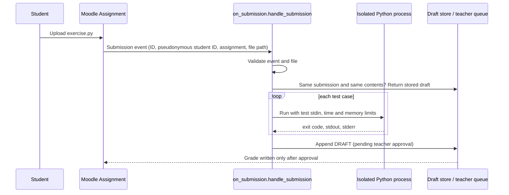

# On-submission grading

**Status: implemented and tested, not yet connected to the live Moodle course.** The handler, its bubblewrap sandbox, the queue worker, and their test suites are complete and run in CI. The Moodle event listener that feeds the queue is described below.

## Why grade on submission

The weekly batch grader (`grader/auto_grade.py`) fits the one-hour-per-week grading budget, but students wait days to learn whether their code even runs. For Coding Exercises, the rubric splits points evenly between running without errors and producing the correct output. Both halves can be checked by running the program, so they can be checked within seconds of upload.

## Flow



## Scoring

The Coding Exercise rubric standard: **50% runs, 50% correct**, three bands.

| Band | When | Score | Held for review? |
|---|---|---|---|
| `flawless` | Every test run exits cleanly and every output matches | Full credit | No |
| `does_not_run` | Any run fails with a syntax or runtime error | 0 | No. The error is a fact, and feedback quotes it |
| `runs_with_issues` | Every run exits cleanly, but some outputs are wrong | Runs half, plus the correct half scaled by tests passed | **Yes.** The rubric gives partial credit "depending on how close," which is a judgment call |
| none | A run timed out, the file is invalid, or no exercise spec exists | No score | **Yes**, with the reason |

Test cases check that the output contains expected text and, optionally, does not contain specific wrong output. For example, the classic type-conversion bug prints `3333333333` instead of `30`, and the test names that exact mistake.

Every result carries `"release": "pending_teacher_approval"`. The handler has no code path that writes a grade a student can see.

## What it refuses to grade, and why

| Situation | Behavior |
|---|---|
| Malformed event | Rejected and not stored. The caller gets the error |
| No exercise spec for the assignment | Held. Never scored against a missing rubric |
| No file, several files, or not a `.py` file | Held with the reason |
| File path outside the submissions folder | Held. Blocks an event that points the grader at a file it should not touch |
| Missing, empty, oversized, or non-UTF-8 file | Held with the reason |
| Any run times out | Held, unscored. Usually an infinite loop or a program waiting for input the test did not give |
| The grader itself throws | Held with the error. One bad submission can never take down the queue |

## Duplicates and resubmissions

Webhook-style events can arrive twice. Results are stored in an append-only JSON Lines file keyed by submission ID and a SHA-256 hash of the file contents:

- Same submission ID, same contents: the stored draft is returned, marked `"duplicate": true`, and nothing runs again.
- Same submission ID, new contents (the student resubmitted): graded again, and the newest draft wins.

## Isolation, and its limits

Each test runs the student's file in a separate Python process:

- **Isolated mode** (`-I`): ignores environment variables, user site-packages, and the current directory on the import path.
- **Minimal environment**: the child sees only the variables needed for UTF-8 output, never the grader's.
- **Time limit** per run, from the exercise spec.
- **Memory and file-size limits** through `resource.setrlimit` on POSIX systems. A runaway allocation fails with `MemoryError` instead of exhausting the server.
- **Output capped** at 10,000 characters per stream.

Those limits stop runaway programs, not hostile ones. On its own, a determined program could still read files the grading user can read, or open network connections.

### The sandbox

With `--sandbox bwrap` (the default in the queue worker), every run also happens inside a [bubblewrap](https://github.com/containers/bubblewrap) sandbox ([`grader/sandbox.py`](../grader/sandbox.py)):

- **No network.** A fresh network namespace with nothing in it.
- **Its own process list.** The grader's processes, and their environment, are invisible. That matters because the queue worker holds the AI subscription token.
- **A read-only filesystem with almost nothing in it:** `/usr`, the one submitted file at `/sandbox/<name>`, fresh `/proc` and `/dev`, and an empty, writable `/tmp` as the working folder. Other students' files, `/home`, `/etc`, and `/var` don't exist inside.
- **An empty environment,** apart from two encoding settings. No capabilities, no access to the grader's terminal, and it dies with the grader.

It needs no root, no sudo rules, and no container runtime: bubblewrap uses unprivileged user namespaces. **It also checks itself.** Before grading anything, `sandbox_self_test()` runs a probe program inside the sandbox. The probe tries the network, a file planted next to it, host folders, the grader's process, and writing outside `/tmp`, and the self-test names every property that fails. The worker refuses to start if any does.

The tests include a hostile program that is also a correct answer. It tries to read a secret planted next to it, read every process's environment, reach the network, and overwrite itself. Inside the sandbox it finds nothing and still gets full marks. The same program run without the sandbox finds the secret, so the tests show it is the sandbox doing the blocking. Every fixture gets the same grade with and without the sandbox.

The service running the worker also caps total processes and memory, so a fork bomb or memory hog hits a limit before it can hurt the server.

## Moodle integration

Built and tested; not yet running on the live server.

1. **Event listener.** A small Moodle plugin observes `\mod_assign\event\assessable_submitted`. For an allowlisted Coding Exercise, it copies the submitted file out of Moodle's file store and atomically writes an event JSON (submission ID, pseudonymous username, assignment ID, file path) to the queue's `incoming/` folder. It never grades, and a queue failure never blocks a submission.
2. **Worker.** [`grader/review_worker.py`](../grader/review_worker.py) picks up each event and runs `on_submission.py`. Flawless and does-not-run drafts need no model: the program run settled them. A `runs_with_issues` draft, the one band that needs judgment, goes to Claude with the code, the exercise rubric, and the run results marked as trusted facts. Held drafts go straight to the teacher.
3. **Release check.** AI review results land in the folder layout the [release check](release-check.md) reads, alongside the draft store, so any review that contradicts the program run or quotes code the student didn't write is blocked before the teacher sees the batch.
4. **Approval and write-back.** On approval, the grade and feedback are written back through Moodle's grade API, the same way approved grades are written today.

**Cost.** The AI step runs through Claude Code in non-interactive mode (`claude -p`) on a Claude subscription, so it adds no per-token API bill. The worker checks `claude auth status` before it processes anything and refuses to start unless Claude Code is signed in to a subscription. It removes API-key variables from the child process, because Claude Code prefers an API key when one is present. Each call runs in an empty folder with tools, project instructions, hooks, plugins and MCP servers turned off. Calls count against the plan's usage limits; a review that fails for any reason goes to a `failed/` folder with its reason and is never retried automatically.

**Before it goes live.** Install bubblewrap on the server and confirm the sandbox self-test passes there. Some Ubuntu releases restrict unprivileged user namespaces by default, and the self-test reports it if so.

## Testing

`grader/tests/test_on_submission.py` runs real student-style programs through the real subprocess path. CI enforces **100% line and branch coverage** of `on_submission.py`. Fixtures cover a correct solution, a valid alternative, string repetition instead of multiplication, a partially correct program, a syntax error, a runtime error, an infinite loop, a memory hog, a program trying to talk to "the autograder," and a program that reports its own environment to prove isolation. Mutation testing then changes the grading code one small step at a time (about 170 changes) and requires a test to catch each one, beyond what coverage can show. See [testing.md](testing.md).

## Try it

```bash
python grader/on_submission.py examples/on-submission/event-runs-with-issues.json \
  --exercises grader/exercises \
  --submissions-root grader/tests/on_submission_fixtures \
  --store out/drafts.jsonl
```

Committed results for three example events are in [`examples/on-submission/`](../examples/on-submission/).
