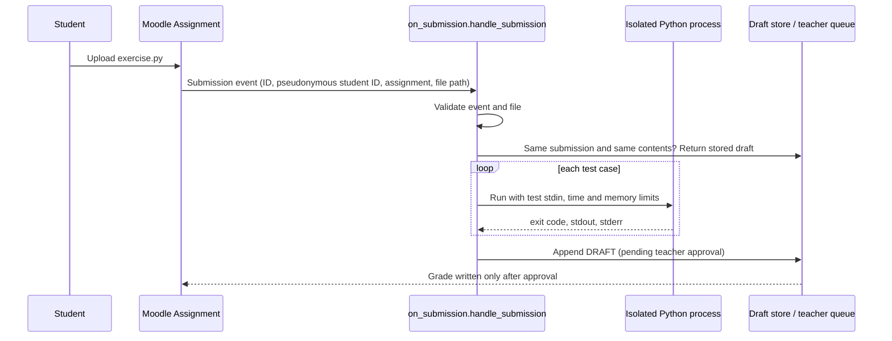

# On-submission grading

**Status: implemented and tested, not yet connected to the live Moodle course.** The handler, its sandboxing, and its test suite are complete and run in CI. The Moodle hook that would call it on every upload is designed below but not built.

## Why grade on submission

The weekly batch grader (`grader/auto_grade.py`) fits the one-hour-per-week grading budget, but students wait days to learn whether their code even runs. For Coding Exercises, the rubric splits points evenly between running without errors and producing the correct output. Both halves can be checked by running the program, so they can be checked within seconds of upload.

## Flow



## Scoring

The Coding Exercise rubric standard: **50% runs, 50% correct**, three bands.

| Band | When | Score | Held for review? |
|---|---|---|---|
| `flawless` | Every test run exits cleanly and every output matches | Full credit | No |
| `does_not_run` | Any run fails with a syntax or runtime error | 0 | No. The error is a fact, and feedback quotes it |
| `runs_with_issues` | Every run exits cleanly, but some outputs are wrong | Runs half, plus the correct half scaled by tests passed | **Yes.** The rubric gives partial credit "depending on how close," which is a judgment call |
| none | A run timed out, the file is invalid, or no exercise spec exists | No score | **Yes**, with the reason |

Test cases check that the output contains expected text and, optionally, does not contain specific wrong output. For example, the classic type-conversion bug prints `3333333333` instead of `30`, and the test names that exact mistake.

Every result carries `"release": "pending_teacher_approval"`. The handler has no code path that writes a grade a student can see.

## What it refuses to grade, and why

| Situation | Behavior |
|---|---|
| Malformed event | Rejected and not stored. The caller gets the error |
| No exercise spec for the assignment | Held. Never scored against a missing rubric |
| No file, several files, or not a `.py` file | Held with the reason |
| File path outside the submissions folder | Held. Blocks an event that points the grader at a file it should not touch |
| Missing, empty, oversized, or non-UTF-8 file | Held with the reason |
| Any run times out | Held, unscored. Usually an infinite loop or a program waiting for input the test did not give |
| The grader itself throws | Held with the error. One bad submission can never take down the queue |

## Duplicates and resubmissions

Webhook-style events can arrive twice. Results are stored in an append-only JSON Lines file keyed by submission ID and a SHA-256 hash of the file contents:

- Same submission ID, same contents: the stored draft is returned, marked `"duplicate": true`, and nothing runs again.
- Same submission ID, new contents (the student resubmitted): graded again, and the newest draft wins.

## Isolation, and its limits

Each test runs the student's file in a separate Python process:

- **Isolated mode** (`-I`): ignores environment variables, user site-packages, and the current directory on the import path.
- **Minimal environment**: the child sees only the variables needed for UTF-8 output, never the grader's.
- **Time limit** per run, from the exercise spec.
- **Memory and file-size limits** through `resource.setrlimit` on POSIX systems. A runaway allocation fails with `MemoryError` instead of exhausting the server.
- **Output capped** at 10,000 characters per stream.

This stops runaway programs. It is **not a security boundary** against hostile code: a determined program can still read files the grading user can read, or open network connections. A production deployment should run the handler inside a disposable container with no network access, a read-only filesystem except a scratch folder, and a non-privileged user. That is the main remaining work before connecting it to the live course.

## Planned Moodle integration

1. A small Moodle plugin observes `\mod_assign\event\assessable_submitted` and writes an event JSON (submission ID, pseudonymous username, assignment ID, stored file path) to a queue folder.
2. A worker on the server, running in the container described above, calls `on_submission.py` for each queued event.
3. Drafts appear in the teacher's review queue. Flawless and does-not-run drafts can be approved in bulk; held drafts go to the AI-assisted review tier first.
4. On approval, the grade and feedback are written back through Moodle's grade API, the same way approved grades are written today.

## Testing

`grader/tests/test_on_submission.py` runs real student-style programs through the real subprocess path. CI enforces **100% line and branch coverage** of `on_submission.py`. Fixtures cover a correct solution, a valid alternative, string repetition instead of multiplication, a partially correct program, a syntax error, a runtime error, an infinite loop, a memory hog, a program trying to talk to "the autograder," and a program that reports its own environment to prove isolation. Mutation testing then changes the grading code one small step at a time (about 170 changes) and requires a test to catch each one, beyond what coverage can show. See [testing.md](testing.md).

## Try it

```bash
python grader/on_submission.py examples/on-submission/event-runs-with-issues.json \
  --exercises grader/exercises \
  --submissions-root grader/tests/on_submission_fixtures \
  --store out/drafts.jsonl
```

Committed results for three example events are in [`examples/on-submission/`](../examples/on-submission/).
