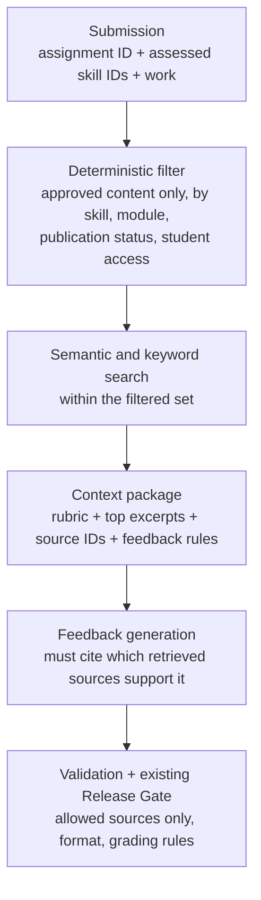

# Retrieval (RAG) roadmap

**Status: planned. Nothing here is built.** This is a design for a separate experiment, kept out of the live grading workflow until it is evaluated.

## Why consider retrieval at all

Today the reviewer gets the rubric and the feedback spec. It does not get the lesson the student actually learned from. So when it spots a misconception, its advice is correct but generic. Retrieval could ground feedback in the course's own explanations, terminology, and practice resources, and point the student to the specific place to review.

That is a specific problem retrieval would solve. Adding it without one would be complexity for its own sake.

## FoxCS already does a simple form of retrieval

Selecting a rubric by assignment ID and putting it in the reviewer's context is deterministic retrieval. Embeddings and a vector index only earn their place when content needs to be found by meaning across a larger library, for example when a student writes "my function doesn't give back the value" instead of using the word "return".

## Candidate applications

| Option | Description | Verdict |
|---|---|---|
| **A. Feedback linked to the most relevant lesson** | When the reviewer identifies a misconception, retrieve the approved lesson excerpt or practice resource for that skill and cite it | **First project.** Extends an existing workflow, has a clear success criterion, testable with synthetic submissions |
| B. Curriculum-grounded student tutor | Answers questions using only lessons the student can access, without exposing assessment answers | Later. Higher privacy and permission stakes |
| C. Authoring assistant | Retrieve objectives, examples, and standards before generating new practice items, to stay consistent and avoid duplicates | Useful, internal only |
| D. Teacher intervention support | Retrieve approved strategies for skills a class is struggling with, from aggregate data only | Useful once the dashboard exists |

## Proposed pipeline for option A

**Grade calculation stays separate from retrieval.** Retrieval can change which explanation or resource the feedback points to. It can never change a score or override the assignment rubric.

### Resource record (illustrative)

| Field | Example |
|---|---|
| `resource_id` | `lesson_functions_return` |
| `skill_ids` | `functions.return_values` |
| `module` | Functions |
| `access_level` | `published_to_students` |
| `content` | Approved lesson excerpt |
| `source_link` | Canonical Moodle resource reference |
| `embedding` | Vector for semantic search |

Lessons are already authored per skill, which makes the deterministic filter straightforward.

## Build stages

1. **Deterministic retrieval only.** 20 to 40 approved excerpts tagged by skill ID, fetched with plain Python or SQL. No embeddings. Establishes the baseline.
2. **Add semantic search.** A local embedding model and a small index (or Postgres with pgvector for hybrid keyword plus vector search). Compare against the skill-ID baseline on the same cases.
3. **Integrate with feedback generation.** Pass excerpts and source IDs to the reviewer and require it to name the sources that support each piece of advice.
4. **Evaluate before any deployment.** Extend `evals/` with retrieval cases.

## What to measure

| Metric | Question |
|---|---|
| Retrieval recall | Is the correct resource in the top results? |
| Retrieval precision | How many returned resources are actually relevant? |
| Groundedness | Is every claim in the feedback supported by a retrieved source? |
| Citation validity | Does every cited source exist and belong to the allowed set? |
| Instructional usefulness | Does the next step help the student? (educator review) |
| Permission safety | Are assessment answers and restricted content never retrieved? |
| Cost and latency | Is the improvement worth the added complexity? |

Retrieval quality and generation quality are evaluated separately. A system can retrieve the right lesson and still write poor feedback, or write sensible feedback from the wrong source.

Example eval case: a student uses `print()` where a return value is required. Expected retrieved resource: the return-values lesson. Expected feedback: names the distinction, explains the consequence, links that lesson.

## Boundaries

- **Student privacy.** Prototype only with synthetic submissions. Student work never enters the retrieval corpus.
- **Source permissions are enforced in code, before retrieval.** Assessment items, answer keys, and licensed material are excluded at the filter step. A prompt telling the model not to reveal answers is not a security boundary.
- **Retrieved text is untrusted.** It cannot override system instructions, grading rules, or permissions.

## A negative result is still a result

If deterministic skill mapping beats vector search for tightly scoped assignments, that is a worthwhile finding and will be documented as one. The point is to measure whether retrieval helps, not to adopt it because it is popular.
